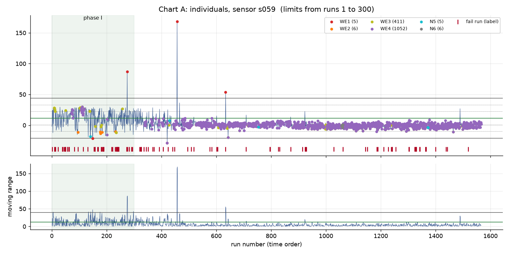
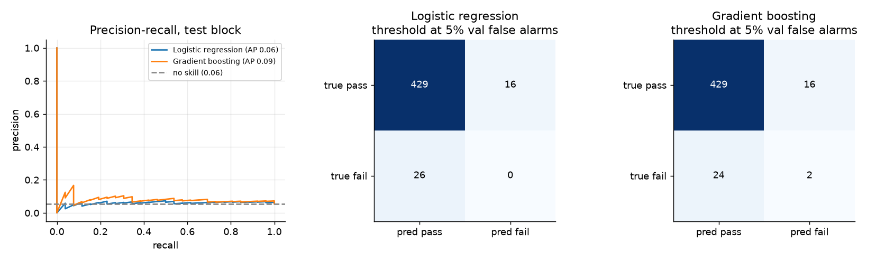

# secom-spc

Statistical process control and a fail-prediction study on the public UCI SECOM semiconductor
dataset (1567 runs, 590 anonymized sensors, pass/fail labels with timestamps). The notebook
`secom_spc.ipynb` audits the data, builds individuals and moving-range charts with phase I limits and
Western Electric / Nelson rule checks, adds EWMA and CUSUM views, demonstrates process capability
with clearly labeled assumed limits, and trains a fail predictor on a time-ordered split with
bootstrap confidence intervals. The analysis code is in `src/secom_spc/` with pytest tests. The
predictor does not clearly beat chance, and the notebook says so.

## Headline results

All numbers come from the executed notebook (random seed 42).

1. **Data audit.** 104 of 1567 runs fail (6.64%) over 89 days. 116 of 590 sensors are constant and
   28 are missing in more than half the runs.
2. **Autocorrelation decides whether a chart can be trusted.** Chart limits come from the first 300
   runs. Sensor s405 has lag-1 autocorrelation 0.854 in that window and a sample standard deviation
   3.5 times its moving-range sigma. In phase II its individuals chart flags 81% of runs (61% beyond
   3 sigma, against 0.27% expected for in-control normal data). Sensor s001 is essentially
   independent (lag-1 0.001) and flags 2.4% of phase II runs.
3. **Time is a confound.** Sensor s059 was the best fail/pass separator in the training block, but
   its level falls steadily over the first several weeks while the fail rate falls with it (13% and
   17% in the first two 150-run blocks, mostly 3% to 4% afterward). Its phase I window is not a
   stable baseline.
4. **Fail prediction is weak.** On the last 30% of runs (471 runs, 26 fails, no-skill PR-AUC 0.055):

   | Model | PR-AUC (95% CI) | Recall at validation-set 5% false-alarm threshold | Realized false-alarm rate |
   |---|---|---|---|
   | Logistic regression | 0.064 (0.041 to 0.110) | 0 of 26 | 0.036 |
   | Gradient boosting | 0.085 (0.052 to 0.167) | 2 of 26 | 0.036 |

   A label-shuffle test puts both inside the range expected from no information (43% and 15% of
   shuffles match or beat the observed PR-AUC).





## Reproduce

```
uv sync
uv run python scripts/fetch_data.py
uv run jupyter nbconvert --to notebook --execute --inplace secom_spc.ipynb
```

Tests and lint: `uv run pytest` and `uv run ruff check .`. The download script checks the archive
against a pinned SHA-256 before extracting two files into `data/`, which is gitignored.

## Limitations

- Sensors are anonymized with no names, units, tool or step information. Findings are about
  statistical behavior, not about a real process.
- SECOM has no specification limits. The capability section uses assumed limits (phase I mean plus
  or minus four standard deviations) to show the calculation; they are not real specs.
- Only 104 fails exist and 26 are in the test block, so every model interval is wide. Bootstrap
  resampling treats runs as independent, which makes the intervals optimistic if runs are
  autocorrelated.
- The alarm threshold is set on a 220-run validation block with 6 fails of its own; it realized a
  3.6% false-alarm rate on test rather than the 5% target.
- Phase I (first 300 runs) contains 44 fails and a drifting sensor level, so it is a convenient
  baseline, not a verified in-control one.
- The data covers one quarter of 2008. Hyperparameters were fixed by judgment and not tuned; a
  tuned or feature-selected model might do better or might not.

## License

MIT. The SECOM dataset is from the UCI Machine Learning Repository (McCann and Johnston, 2008) and
is not redistributed here.
